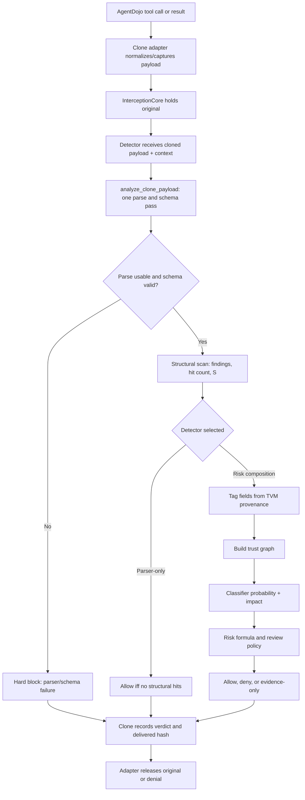

# Pipeline: detector-stage integration and handoff

`src/pipeline` is the integration space for detector stages. It connects framework-neutral cloned traffic supplied by `src/clone` to parsing, tagging, graph classification, risk assessment, and review. Keep stage orchestration and shared stage state here; keep framework interception and audit behavior in `src/clone`.

## Clone -> Parser flow



```mermaid
sequenceDiagram
    participant Agent
    participant Adapter as Clone / AgentDojo adapter
    participant Core as InterceptionCore
    participant Detector as Parser / risk detector
    participant Ledger
    participant Tool
    Agent->>Adapter: proposed call
    Adapter->>Core: normalized args + trusted schema
    Core->>Ledger: capture pre-hop payload
    Core->>Detector: deep copy + direction/tool/schema context
    Detector-->>Core: decision
    alt pre-hop allowed
        Core->>Tool: execute original call
        Tool-->>Adapter: formatted result
        Adapter->>Core: result + pre interception id
        Core->>Ledger: capture post-hop result
        Core->>Detector: result string + declared return schema
        Detector-->>Core: decision
        Core->>Ledger: record release/block and delivered hash
        Core-->>Agent: original result or denial
    else pre-hop blocked
        Core->>Ledger: record block and denial delivery
        Core-->>Agent: denial; tool not executed
    end
```

### Formula and decision boundaries

The parser's structural score is `S = min(1, counted_hits / max(1, boundaries))`. A boundary is a JSON object, array, or key; scalar leaf values do not increase the denominator. Duplicate keys and counted forged-structure patterns contribute hits. Parse status is separate: malformed/over-limit JSON is hard-blocked even though its `S` is zero. Schema failures are also hard-blocked. In the risk-composed path, structural hits are evidence for the classifier and risk assessment; they no longer bypass that path. Parser-only mode still blocks any counted structural hit.

The risk gate does not treat structural density `S` as a probability. It keeps the calibrated classifier score separate and computes `risk = classifier_probability * impact`. Any counted structural finding independently forces human review, even when a large boundary count makes `S` very small. If classifier evidence is unavailable, the gate also forces review. This prevents heuristic-score dilution and prevents missing model evidence from silently auto-allowing traffic. Parser/schema failures remain hard blocks; high classifier risk removes `allow` from reviewer options.

### Post-hop retention

Every post-hop result is captured in the ledger's `raw_payloads` before detector evaluation. The result remains available in memory after release or block, and ledger events retain its input hash plus the hash of the delivered observation. For durable snapshots, construct the ledger with an explicit directory:

```python
ledger = InterceptionLedger(storage_dir="runs/current/clone-ledger")
```

The ledger refreshes `ledger.jsonl`, `raw-payloads.jsonl`, and `run-metadata.jsonl` after each capture/state transition. Raw files contain tool results and may contain private data, so persistence is explicit rather than enabled by default. The live smoke runner enables persistence under a timestamped `runs/live_clone_parser_smoke/` directory, reloads the event ledger, and checks the post-hop payload hashes against the captured records.

## Current implementation

Today this folder contains:

- `clone_parser_detector.py`: a detector callback that receives a cloned payload and `DetectorContext`, creates the parser's `ToolTraffic`, runs `parse()` and `structural_flags()`, and returns a `DetectorDecision`.
- `parser_analysis.py`: shared one-pass payload normalization, parse, schema validation, and structural analysis for parser-only and risk-composed paths.
- `test_clone_parser_detector.py`: focused tests for the current bridge behavior. Check these tests when changing parser policy; an older expectation that plain prose is blocked may need reconciliation with `ParseStatus.NOT_JSON`.

The callback returns the final decision fields (`allowed`, `label`, `score`, `reason`, and `contains_adi`). Its internal `ParserAnalysis` retains the `ParseResult` and `StructuralReport` for downstream tagging/classification without reparsing. For schema checks, the adapter passes the runtime's trusted argument model for pre-hop and declared return type for post-hop.

The structural score is a deterministic heuristic, not a probability or SVM score:

```text
min(1, counted_structural_findings / parser_boundary_count)
```

The parser reports parse status separately. Plain prose without a trusted schema is `NOT_JSON`, score `0`, and blocked as `parser-untrusted`; it is accepted only when a registered direction-specific schema validates the raw text (for example, a declared string return type). Malformed object/array JSON is also blocked as `parser-untrusted` without being labeled ADI. Valid structured payloads are scanned for counted structural findings; prose containing such findings is blocked as `adi-detected`.

## How clone supplies traffic

The AgentDojo executor in `src/clone/adapters/agentdojo.py` intercepts each call/result and invokes `InterceptionCore`. Core holds the original until the detector decision and passes the detector a deep copy:

- **Pre-hop:** normalized `{"tool": tool_name, "args": args}` dict, where the adapter has applied `_framework_args`.
- **Post-hop:** the exact formatted tool-result string.

The parser bridge receives that clone as its `payload` argument. The `DetectorContext` identifies `"pre"`/`"post"`, tool name, call ID, matrix entry, and the optional runtime schema. For pre-hop the parser analyzes the cloned `args` object; for post-hop it analyzes the exact formatted result string. TVM/ledger are for mapping, trace, and audit; parser scoring does not infer schemas from them. The ledger keeps its own raw-payload snapshot, separate from the detector's working copy.

Wire the current parser bridge into the AgentDojo executor as follows:

```python
from clone import InterceptionLedger, TrustVerificationToolsExecutor, load_tool_matrix
from pipeline.clone_parser_detector import parser_detector

ledger = InterceptionLedger()
executor = TrustVerificationToolsExecutor(
    parser_detector,
    ledger=ledger,
    tool_matrix=load_tool_matrix(),
    mode="enforce",
)
```

The bridge requires context; calling `parser_detector(payload)` without it raises `ValueError`. Existing one-argument detectors remain supported by clone, but this parser bridge specifically needs the contextual callback form.

## Next stage: field-by-field tagging

The next detector stage is tagging. Its input should be the **cloned pre/post payload**, not a replacement payload reconstructed from ledger state. The parser's structural score is an output of parser analysis that the pipeline can pass to later stages. Per the intended interface, tagging should inspect/tag each field of the cloned call/result and may consume the parser score, but it should not require the TVM/ledger or depend on a `ParseResult` being passed as its primary input.

The parser-only callback returns a single `DetectorDecision`. The optional composed classifier path now tags parser fields using explicit TVM field trust classes, builds a provenance graph, classifies it, and applies risk/review policy. The pipeline-owned intermediate contract carries:

1. **Clone input:** the deep-copied pre-hop dict or post-hop string plus `DetectorContext`.
2. **Parser stage output:** parse status, structural findings/report, and score.
3. **Tagging stage output:** field-level tags produced from the cloned traffic, associated with stable field paths and direction.
4. **Later analysis:** tool-dependency graph, WL-kernel representation, and SVM/classifier outputs.
5. **Final decision:** allowed/blocked, label, score(s), ADI result, and a reason that clone can record and enforce.

Keep this shared multi-stage state in `src/pipeline`, not `InterceptionCore`. Do not put parsed results, tags, graph state, or classifier implementation into the clone ledger. The ledger is the audit trail; the pipeline owns intermediate detector artifacts.

Suggested implementation sequence for the next contributor/agent:

1. Expand TVM field trust annotations from their current `unclassified` defaults using verified provenance policy.
2. Train and validate the SVM using labeled graph JSONL from project/AgentDojo runs.
3. Connect a human review callback/UI to display `EvidencePanel` and capture the reviewer action.
4. Run provider-backed AgentDojo evaluation and populate evaluation JSONL.

## Classifier, risk gate, and evaluation handoff

The following reusable components are now available:

- `classifier.wl_svm`: `GraphSnapshot`, deterministic Weisfeiler-Lehman subtree features, and a linear SVM with sigmoid probability calibration. It expects the graph builder to supply categorical trust/provenance node labels and edges; it does not create graphs from raw parser output.
- `trust_graph.tagging.tag_fields`: tags each parsed field from its top-level TVM class; unknown classes default to `UT`. Nested fields inherit their top-level argument class.
- `trust_graph.graph.build_trust_graph`: builds parent-child field edges and attaches structural finding nodes.
- `classifier.train`: trains an artifact from labeled graph JSONL. Each row contains a unique `case_id`, `label` (`benign` or `attack`), and `graph` with `node_labels` and `edges`. Each class needs at least two examples for calibration.
- `pipeline.classifier_gate.classify_and_assess`: applies classifier probability to trusted impact tier (1/5/10) and keeps parser structural density as separate evidence.
- `pipeline.risk_gate`: `risk = classifier_probability * impact`. Risk below 1 auto-allows only when there are no structural hits and classifier evidence exists; `[1, 5)` requires review; `>=5` requires review with `allow` removed. Any structural hit or missing classifier forces review regardless of the numeric risk score.
- `pipeline.evidence_panel`: deterministic JSON evidence packet for a reviewer; it does not call an LLM or expose raw untrusted content automatically.
- `pipeline.evaluation`: computes attack success rate, benign utility, utility under attack, false positive/negative rates, and human approval accuracy from per-case JSONL results.
- `pipeline.risk_detector.make_risk_detector`: creates an opt-in contextual detector that composes parser/schema checks, tagging, graph construction, SVM, risk assessment, and an optional reviewer callback. If a review-tier case has no callback, it is blocked. Parser/schema failures remain blocked without asking the reviewer.

Example commands (run from the repository root in PowerShell):

```powershell
$env:PYTHONPATH = "src"
python -m classifier.train .\graphs.jsonl .\wl_svm.joblib
python -m pipeline.evaluation .\evaluation_cases.jsonl
```

Training graph JSONL and evaluation JSONL must come from labeled project/AgentDojo runs; this repository does not fabricate training data. Evaluation rows require `case_id`, `label`, `task_success`, and `flagged`; attack rows also require `attack_success`. Optional `human_decision` is `allow`, `deny`, or `evidence_only`. Human approval accuracy counts `allow` as correct for benign cases and any non-allow action as correct for attack cases.

The classifier/gate path is available as an opt-in detector factory; the default `parser_detector` example still uses parser/schema policy only. Effective risk enforcement depends on a trained model and a reviewer callback for review-tier cases. Current TVM impact tiers are policy defaults and current field classes are all `unclassified`, so those fields conservatively tag as `UT`. Post-hop review can withhold a result from the agent but cannot undo a side effect the tool has already completed.

To opt in after training a model, construct the executor with `make_risk_detector(WLGraphSVM.load("wl_svm.joblib"), reviewer=your_review_callback)`. The callback receives `(RiskAssessment, EvidencePanel)` and returns `allow`, `deny`, or `evidence_only`. Keep the matrix's current `unclassified` values as untrusted until the project has evidence to assign trusted provenance; the current checked-in matrix has no explicit trusted field annotations. If no reviewer callback is provided, moderate/high risk is denied. Post-hop review controls only whether the response reaches the agent; it cannot reverse an already executed side effect.

## Testing and validation

Run from the repository root:

```powershell
python -m pytest -q --durations=5 src\clone\test_static.py
python -m pytest -q --durations=5 src\parser
python -m pytest -q --durations=5 src\pipeline\test_clone_parser_detector.py
```

The clone static tests cover interception lifecycle, ledger/hash behavior, matrix lookups, import isolation, and a fake/local AgentDojo runtime. Parser tests use fixed fixtures. These are **static/local tests only**: the integration has **not been tested with Groq** or a live Groq-backed AgentDojo pipeline. A Groq-backed run must still validate pre/post call behavior, model-visible observations, detector latency/timeouts, and `off`/`passthrough`/`enforce` outcomes.

The pipeline bridge test command may currently fail if its legacy assertion still expects ordinary prose to be blocked. Under the current `NOT_JSON` policy, clean prose is allowed. Update that expectation only when the test is reviewed against the intended parser policy; do not hide the mismatch by skipping the test.

## Handoff rules for AI agents and teammates

- Read `src/clone/README.md` for the interception API, mode behavior, hashes, TVM, ledger, and exports.
- Extend detector stages under `src/pipeline`; avoid coupling tagging to AgentDojo or clone internals.
- Treat the cloned payload as the detector's traffic input. The parser score is an analysis result; the ledger is audit-only for tagging.
- Preserve direction, tool name, call ID, and stable parser field paths through stages.
- A missing score/tag/classifier output means “not produced,” not “clean.”
- Do not claim live-provider compatibility until a Groq-backed AgentDojo integration run has passed.
